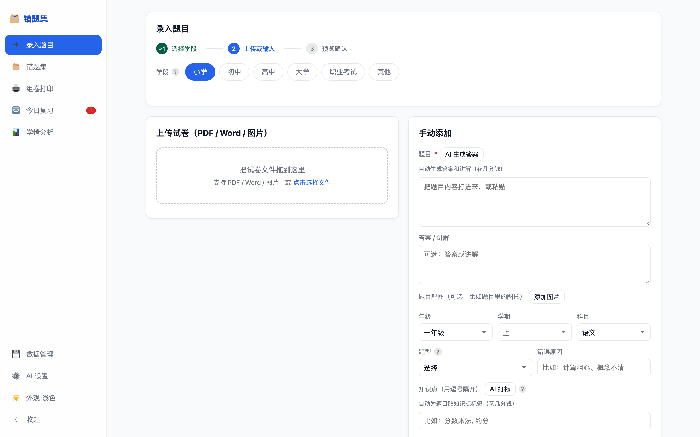
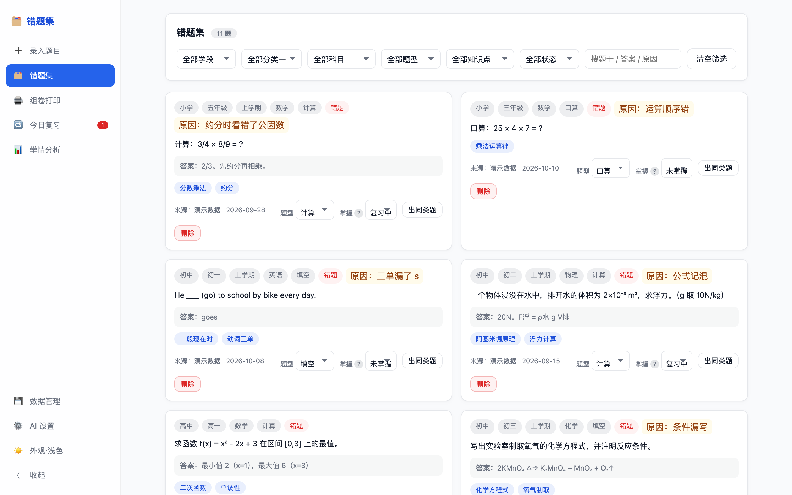
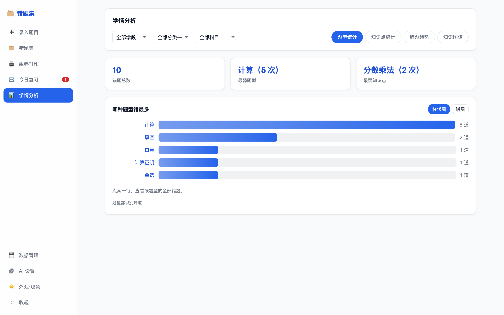
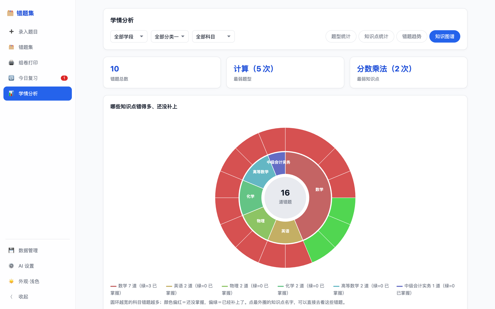
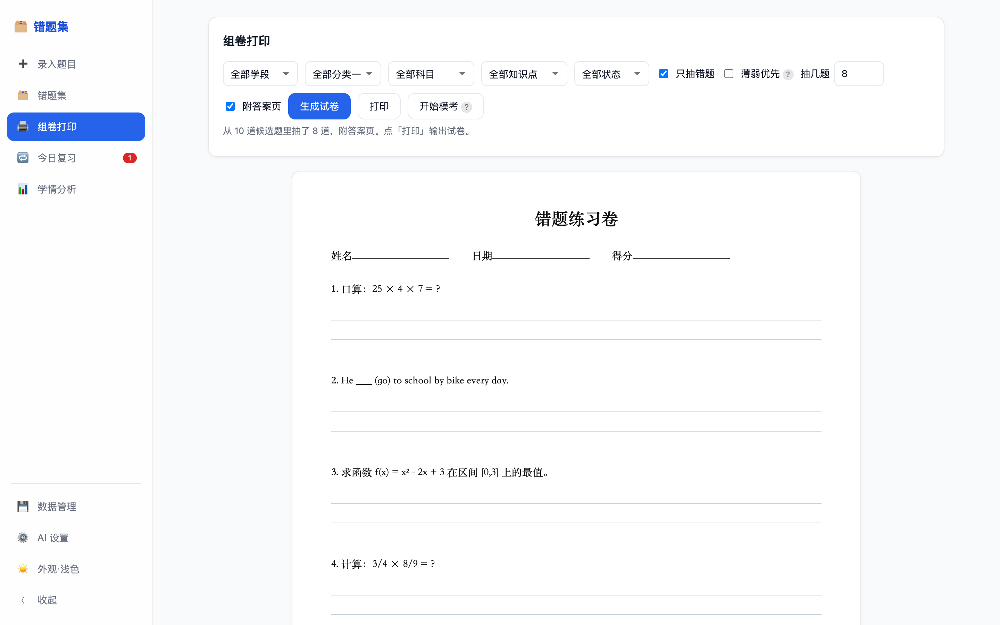
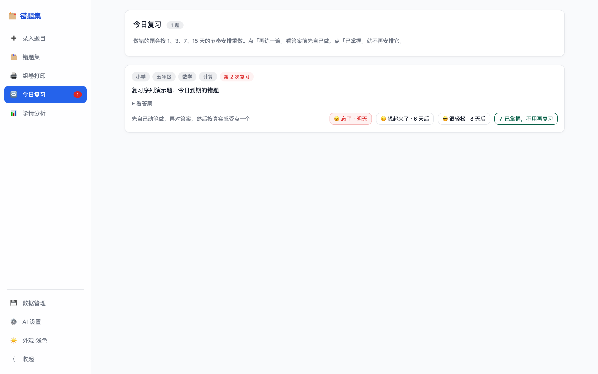
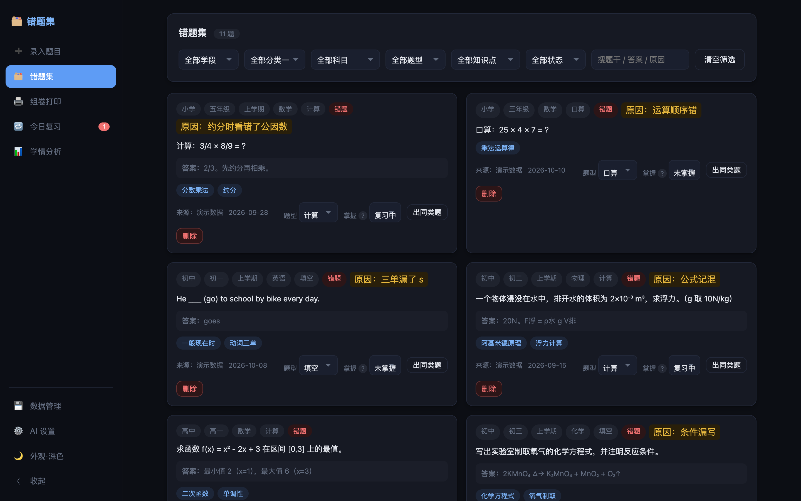
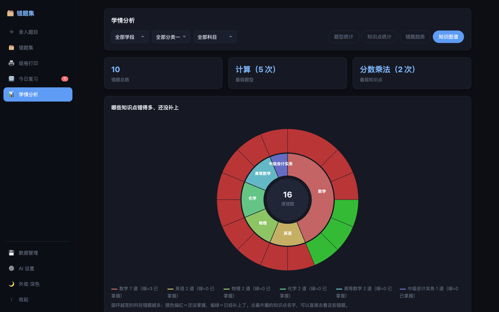

<div align="center">


# 错题集 · ErrorNotebook

**本地优先的智能错题管理工具 —— 试卷秒变错题本，AI 找出薄弱点，一键组卷打印**

[](https://github.com/SteveSunYifan/error-notebook/actions/workflows/build.yml)
[](https://github.com/SteveSunYifan/error-notebook/releases)
[](LICENSE)
[](#-快速开始)
[](https://github.com/SteveSunYifan/error-notebook/stargazers)

**[English](README.en.md)** | 中文

**数据 100% 本地存储 · 无账号无云端 · AI 可选自配** · 安装包仅 4~6MB · 启动 <1 秒

</div>

---

## 💡 为什么做这个工具

孩子每次考试的错题散落在试卷、练习册、照片里，家长手工抄题整理费时费力，买来的错题本 App 又强推云账号和订阅。这个项目把整条链路自动化：**上传试卷 → 自动切题 → 勾选错题 → AI 打知识点标签 → 按薄弱点组卷打印**，全程本地运行，数据永远在你自己电脑上。


## 📸 界面预览

<div align="center">

| 录入题目（学段门禁 + 步骤条） | 错题集 |
| --- | --- |
|  |  |

| 题型统计 | 知识图谱（旭日图） |
| --- | --- |
|  |  |

| 组卷打印 | 今日复习（SM-2 三键评分） |
| --- | --- |
|  |  |

**深色模式**：

| 错题集（深色） | 知识图谱（深色） |
| --- | --- |
|  |  |

</div>

## ✨ 功能特性

### 录入

| 功能 | 状态 | 说明 |
| --- | :-: | --- |
| 📄 PDF 试卷上传自动切题 | ✅ | 兼容 `1.` `1、` `(1)` `第1题` 等常见题号格式，预览可编辑 |
| 📝 Word (.docx) 上传切题 | ✅ | 纯 Rust 解析，无需 Office |
| 🖼 图片上传 AI 识别 | ✅ | 拍照/截图 → 视觉模型提取文字 → 切题（需配置视觉模型） |
| ✍️ 手动录入 | ✅ | 题干/答案/题型/错误原因/知识点/**题目配图**；分类随学段联动 |
| 🖼 题目配图 | ✅ | 几何/图表题可附图（png/jpg/webp），卡片展示、随卷打印、导出迁移全链路 |
| 🤖 AI 整卷切分校对 | ✅ | 合并误切、拆出漏切、自动识别题型 |
| 🎯 题型自动识别落库 | ✅ | 切分校对/单题打标自动识别，按学段词表（小学口算~职考申论），历史数据可一键批量补标 |

### 整理与分析

| 功能 | 状态 | 说明 |
| --- | :-: | --- |
| 🗂 多维分类筛选 | ✅ | 学段 × 分类一（年级/课程/考试）× 分类二（科目/章节）× 题型 × 知识点 × 掌握状态 + 关键词搜索 |
| 🤖 AI 知识点自动打标 | ✅ | 从知识点目录约束选取，口径统一；支持 GLM/DeepSeek/Kimi/MiniMax/Qwen |
| 🤖 AI 答案解析生��� | ✅ | 补全参考答案与解题过程 |
| 🤖 AI 同类题生成 | ✅ | 针对薄弱知识点出变式练习，可入库可组卷 |
| 📊 学情分析（题型+知识点） | ✅ | 题型柱状/饼图切换、点击下钻、摘要卡片；知识点条形图 + 掌握状态三色堆叠条 |
| 📈 知识点掌握度加权 | ✅ | 默认只统计「未掌握+复习中」，可切换全部口径 |
| 📉 错题趋势统计 | ✅ | 按周/月新增错题量 + 订正率双线折线图 |
| 🎓 多学段受众（大学/职业考试） | ✅ | 小学/初中/高中/大学/职业考试/其他；大学按课程+章节、考证按考试+科目；内置 55 条种子知识点目录 |

### 练习与输出

| 功能 | 状态 | 说明 |
| --- | :-: | --- |
| 🎲 条件抽题组卷 | ✅ | 随机或**薄弱优先**（按知识点错误数加权抽样），附答题留白，可选答案页 |
| 🖨 一键打印 | ✅ | 系统原生打印管线，支持任何打印机/导出 PDF，配图随卷打印 |
| 🌗 明暗双主题 | ✅ | 自动跟随系统 + 手动三态切换 |
| ⏰ 间隔重复复习计划 | ✅ | 错题按 1/3/7/15 天自动排期；「今日复习」入口带角标，先做后对答案 |
| 📝 模考模式 | ✅ | 限时作答（每题 2 分钟）→ 交卷对照答案自评，「不会」自动排入明日复习 |
| 🪟 平台原生材质 UI | ✅ | 左侧玻璃侧栏（blur+半透明）+ 明暗双主题；窗口层系统材质见方案 §5.5 |

### 数据

| 功能 | 状态 | 说明 |
| --- | :-: | --- |
| 💾 本地 SQLite 存储 | ✅ | `~/.cuotiji/cuotiji.db`，复制即备份；跨版本自动迁移零破坏 |
| 📤 JSON 导入导出 | ✅ | 跨设备迁移，题目配图 base64 内嵌自包含 |
| 🔒 无账号 / 无遥测 / 无云端 | ✅ | 参见[隐私政策](PRIVACY.md) |

## 🚀 快速开始

从 [Releases](https://github.com/SteveSunYifan/error-notebook/releases) 下载最新版：

| 平台 | 文件 | 首次打开 |
| --- | --- | --- |
| macOS (Apple 芯片) | `cuotiji_x.x.x_aarch64.dmg` | 拖入 Applications；如被拦截：右键 → 打开 |
| Windows x64 | `cuotiji_x.x.x_x64-setup.exe` | 双击安装；SmartScreen 点「仍要运行」 |

> 应用未做付费代码签名，首次打开的系统提示属正常现象。数据目录 `~/.cuotiji/`（Windows：`C:\Users\<用户名>\.cuotiji\`）。

## 🤖 AI 配置（可选）

打开应用右上角「AI 设置」→ 选择厂商 → 填入 API Key → 测试连接。**按用途选模型**（2026-10 依据各厂商官方文档核实；模型迭代快，以各家模型列表页为准）：

### 日常任务（打标 / 解析 / 同类题 / 切分）——选便宜文本模型

| 厂商 | 推荐模型 | 说明 |
| --- | --- | --- |
| DeepSeek | `deepseek-flash` | V4.1 世代；缓存命中低至 $0.003/百万 token，**且原生支持视觉**（官方文档核实） |
| Qwen 阿里 | `qwen3.8-flash` | 低价档主力文本模型 |
| GLM 智谱 | `glm-5v-turbo`（多模态两用）/ `glm-5.3` / `glm-5-flash` | 官方视觉模型为 GLM-5V-Turbo；纯文本选 glm-5.3，免费档 flash 系（以 bigmodel.cn 列表为准） |
| Kimi 月之暗面 | `kimi-k3` | K3 系列，当前主力 |
| MiniMax | `MiniMax-M3` | 当前主力 |

### 图片识别（拍照/截图上传）——必须选多模态模型

| 厂商 | 推荐模型 | 说明 |
| --- | --- | --- |
| DeepSeek | `deepseek-flash` | 官方定价页标注 Vision ✓，选它即可两用 |
| Qwen 阿里 | `qwen3.8-omni-flash` | 全模态档；`qwen3.7-plus`/`qwen3.8-max` 也支持图像理解 |
| Kimi | `kimi-k3` | 支持图像理解 |
| GLM | `glm-5v-turbo` | 官方多模态模型，日常任务与图片识别两用 |
| MiniMax | — | 图片识别建议换用其他厂商 |

选 **Mock** 无需 Key，离线体验全部 AI 流程。不配置 AI 不影响其他功能；模型字段为自由输入，厂商上新模型后直接填新 ID ��可用。

## 🗺 Roadmap

- [x] v0.0.1 —— PDF 切题、分类筛选、组卷打印、知识点分析、AI 五能力
- [x] v0.0.2 —— Rust 后端化（安装包 -70%、毫秒启动）、Word/图片上传、明暗主题
- [x] v0.0.3 —— 受众扩展全功能版（一/二/三期）：
  - 一期：学段分类体系（大学/职业考试）、题型统计图表、知识点掌握度加权、侧边栏 UI、新手引导
  - 二期：图片题干、薄弱优先组卷、错题趋势统计
  - 三期：间隔重复复习计划、模考模式
- [x] v0.1.0 Beta —— SM-2 自适应间隔复习、知识图谱（旭日图）、macOS 液态玻璃 / Windows Mica、图标浅深双外观、大学三级分类（门类×课程×学年）、AI 预设更新至当前世代 + 首次配置教程 + GLM Coding Plan、学段门禁与步骤条、UI 明暗主题全面调优
- [ ] 后续 —— 老错题一键排期、知识点图谱社区扩充、Windows 实机验证

完整设计见 [docs/受众扩展方案.md](docs/受众扩展方案.md)。

## 🛠 技术架构

```
Tauri 2 壳（Rust）
 ├─ 进程内嵌 axum HTTP 服务（动态端口，<100ms 就绪）
 ├─ rusqlite 本地数据库（与旧版 schema 零迁移）
 ├─ rust-embed 前端与知识点目录编入二进制
 └─ reqwest(rustls) 调用 OpenAI 兼容 AI 接口
前端：原生 HTML/CSS/JS，零框架零依赖
```

- 后端与原 Python 版 18 个 REST 路由**逐字段对拍一致**，AI prompt 同输入逐字一致（`cargo test` 覆盖）
- legacy Python 版保留在 `server/` 供对比参考

```bash
cd src-tauri && cargo tauri dev      # 开发模式
cargo test && cargo clippy           # 测试与静态检查
./build_macos.sh                     # 本机构建
```

## 🤝 参与贡献

- **知识点目录扩充**是最友好的贡献点：`server/catalog.json`（按年级/科目补充单元知识点，PR 欢迎）
- 功能与 UI 路线见 [受众扩展方案](docs/受众扩展方案.md)，欢迎 Issue 讨论
- 代码贡献：Fork → 分支 → PR（`cargo clippy` 与 `cargo test` 通过即可）

## 📄 相关链接

- [受众扩展方案](docs/受众扩展方案.md)（大学/职业考试人群设计）
- [技术方案文档](docs/方案文档.md)
- [隐私政策](PRIVACY.md) —— 无收集、无账号、无云端
- [MIT License](LICENSE)

---

<div align="center">

**如果这个项目帮到了你家孩子，欢迎点一个 ⭐ Star 支持持续开发**

[](https://star-history.com/#SteveSunYifan/error-notebook&Date)

</div>
